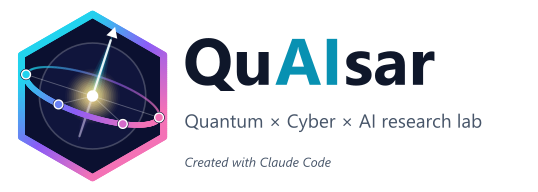

<p align="center">
  <picture>
    <source media="(prefers-color-scheme: dark)" srcset="assets/banner-dark.svg">
    
  </picture>
</p>

<p align="center">
  <a href="https://claude.com/claude-code"></a>
  
  
</p>

# QuAIsar

**Qu**antum + **AI** + qua**sar**: a quantum × cyber × AI security research lab.

Five research starters where quantum computing, security, and machine learning meet.
Every project runs end to end on a CPU laptop in minutes and writes its results to `results/<project>/`.

| # | Folder | Question | Quantum | Cyber | AI |
|---|--------|----------|---------|-------|----|
| 4 | `p4_qml_ids` | Do quantum classifiers help intrusion detection? | quantum kernel SVM, VQC | network intrusion data | classical baselines |
| 5 | `p5_pqc_sidechannel` | Can deep learning extract ML-KEM secrets from power traces? | post-quantum crypto target | side-channel attack | 1-D CNN vs templates |
| 6 | `p6_lwe_ml_attack` | Can a neural net recover an LWE secret? | lattice crypto (PQC basis) | cryptanalysis | SALSA-style model + distinguisher |
| 7 | `p7_adversarial_qml` | Are quantum classifiers robust to adversarial inputs? | VQC | evasion attacks | FGSM / PGD, adversarial training |
| 8 | `p8_rl_quantum` | Can RL learn to decode quantum errors? | surface code QEC | protecting quantum info | Deep Q-Network vs MWPM |

## Get your own copy

This repository is set up as a template.

- **On GitHub:** click **Use this template → Create a new repository**. You get your own repo with a clean history.
- **Or clone it**, replacing the placeholders with your copy's owner and name:

```
git clone https://github.com/<your-username>/<your-repo>.git
cd <your-repo>
```

## Setup

You need **Python 3.10 or newer** and Git. No GPU is needed; the scripts install the CPU build of PyTorch.

**Windows (PowerShell):**

```powershell
.\setup.ps1
```

**macOS / Linux:**

```bash
./setup.sh
```

Both scripts create a virtual environment in `.venv/`, install everything in `requirements.txt`, and check that the key packages import. Options:

| Want to… | Windows | macOS / Linux |
|---|---|---|
| Put the environment elsewhere | `.\setup.ps1 -VenvPath C:\venvs\quaisar` | `./setup.sh ~/venvs/quaisar` |
| Use a specific Python | `.\setup.ps1 -Python py -PythonArgs '-3.12'` | `PYTHON=python3.12 ./setup.sh` |

If Windows refuses to run the script ("running scripts is disabled"), allow it for this one run only:

```powershell
powershell -ExecutionPolicy Bypass -File .\setup.ps1
```

On Windows, a short environment path such as `C:\venvs\quaisar` also avoids "path too long" errors from some quantum packages.

<details>
<summary>Manual setup (any OS)</summary>

```
python -m venv .venv
<venv-python> -m pip install torch --index-url https://download.pytorch.org/whl/cpu
<venv-python> -m pip install -r requirements.txt
```

`<venv-python>` is `.venv\Scripts\python.exe` on Windows and `.venv/bin/python` on macOS / Linux. On macOS, drop the `--index-url` part.
</details>

## Run a project

Activate the environment, then run any project from the repository root:

```powershell
.\.venv\Scripts\Activate.ps1
python p4_qml_ids\run.py
```

```bash
source .venv/bin/activate
python p4_qml_ids/run.py
```

You can skip activation by calling the environment's Python directly, for example `.venv\Scripts\python.exe p4_qml_ids\run.py`. That also works on machines where security policy blocks activation scripts. Every script takes `--help`, and results go to `results/<project>/`.

## Start your own project

```
python new_project.py p9_my_idea "Your one-line research question"
```

This creates `p9_my_idea/run.py` and `p9_my_idea/README.md` from `templates/project/`. The generated script already runs: it repeats the experiment over several seeds, prints mean ± std, and saves `results/p9_my_idea/results.json`. Replace its `run_once()` function with your own experiment, then add a row to the table above.

## Publish your findings

📄 **Latest report:** [QuAIsar-findings.pdf](report/QuAIsar-findings.pdf) · [Word version](report/QuAIsar-findings.docx)

Rebuild the report after re-running any project:

```
python report/build_report.py --pdf
```

The script reads every number from `results/`, so the report always matches your latest runs. It writes `report/QuAIsar-findings.docx`. With `--pdf` it also exports a PDF, using Microsoft Word on Windows or LibreOffice (`soffice`) on macOS / Linux. Use `--author "Your Name"` to change the cover; it defaults to your git user name.

The logo lives in `assets/` (SVG and PNG, light and dark). To change it, edit and run:

```
python assets/make_logo.py
```

## Where each project goes next

**4 · Quantum IDS** — Download UNSW-NB15 (`UNSW_NB15_training-set.csv`) into `p4_qml_ids/data/`; the script picks it up automatically. Then vary `--qubits` and `--train` and plot accuracy and runtime curves. Try projected quantum kernels, and run on IBM hardware via `qiskit` to measure how much hardware noise costs. The honest finding is usually "no quantum advantage yet", and quantifying *why* is the contribution.

**5 · PQC side channels** — The simulator leaks Hamming weights of `s mod q` and `s·c mod q`. The script runs two attack styles with both templates and a CNN. *Direct* classifies `s` from the trace alone and cannot separate s=1 from s=2, which both load with HW 1. *Intermediate* predicts the HW of each intermediate value, then scores every hypothesis `s` against the known ciphertext coefficient `c`. That is how real profiled attacks work. Next steps: capture real traces of liboqs ML-KEM on a ChipWhisperer or use public post-quantum trace sets; add first-order masking (split `s` into two random shares) and show both attacks fail until they combine the two leak points; and attack all 256 coefficients with one shared model.

**6 · ML vs LWE** — Push `--n` and `--h` up until the attack breaks, and chart where. Add BKZ lattice reduction (`fpylll`, easiest under WSL) as the real classical baseline. Then follow SALSA Picante/Verde: preprocess samples with lattice reduction before training, and use transformers.

**7 · Adversarial QML** — Compare against an MLP with matched parameter count, test whether the "concentration" of quantum models makes them more or less robust as qubits grow, and attack the p4 IDS models (evasion against a quantum IDS).

**8 · RL decoding** — Increase `--d 5`, add Y/Z noise (depolarizing) using both Hz and Hx, add measurement errors (repeated syndrome rounds), or replace the DQN with a GNN policy. A second track is RL for QKD: an agent that tunes BB84 basis bias and error-correction parameters under drifting channel noise.

## Caveats

- All quantum circuits run on exact simulators (PennyLane `default.qubit`); no hardware noise or shot noise unless you add it.
- Datasets in 4 (fallback) and 5 are synthetic; label any reported results accordingly.
- Project 6 parameters are intentionally toy-sized and insecure. Nothing here threatens real ML-KEM.

---

<p align="center">
  <br>
  <sub>Created with <a href="https://claude.com/claude-code">Claude Code</a> · MIT License</sub>
</p>
